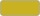
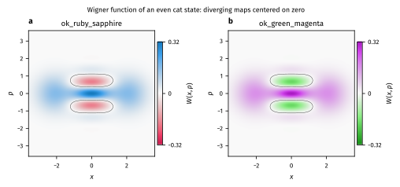
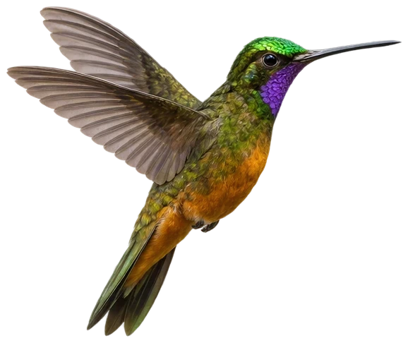

# rhdt-mpl

Personal Matplotlib defaults: the [umbruch](https://github.com/manuel-rhdt/umbruch) backend in the Display P3 color space,
bundled Noto fonts, named palettes and cycles, twelve colormaps, and helpers for adjusting colors in OKLab.

```python
import rhdt_mpl                      # import before pyplot
import matplotlib.pyplot as plt
```

Importing the package does five things:

1. selects the backend `module://umbruch_matplotlib` (PDF output with text and math laid out by umbruch) and tells it that
   every color number is **Display P3** (`umbruch_matplotlib.config.color_space = "display-p3"`, see below),
2. registers the bundled Noto Sans, Noto Sans Mono, Noto Serif and Noto Sans Math with Matplotlib (the backend sends the
   font files Matplotlib picks to umbruch),
3. applies the style `rhdt.mplstyle` and the default color cycle,
4. registers the colormaps (`ok_orchid`, ... and their `_r` versions),
5. registers every palette color under the name `rhdt:<palette>:<name>` and every palette as a color sequence.

`rhdt_mpl.use(backend=False)` re-applies the style without changing the backend, and `rhdt_mpl.use(color_space="srgb")`
opts out of Display P3 (palettes, named colors, cycle and colormaps are then registered as sRGB).

All figures below are produced by this package. They are drawn by the umbruch backend to PDF and converted to SVG with the
text as outlines (`python examples/make_docs.py`).

## Everything in one figure


Panels from the top left: **a** default style and cycle with a rich-text label and a math label; **b** the greyscale-safe
`ok-print` cycle; **c** the default colormap `ok_orchid`; **d** a reversed single-hue colormap; **e** named colors with a
black theory line, a bright highlight and a muted family; **f** the 8-color cycle. The script is `examples/features.py`.

## Style

The style follows the ML-PWS paper figures: full axes box in black, outward ticks, 8 pt text (axis labels 8.8 pt, titles
9.6 pt), 1.5 pt lines, markers of 4 pt without edge, legends without frame, constrained layout, `savefig.bbox = tight`.
The grid is off but styled (`#B0B0B0`, 0.8 pt); `ax.grid()` turns it on.

```python
import rhdt_mpl
fig, ax = plt.subplots(figsize=(rhdt_mpl.TWO_COLUMN, 2.8))   # 510 pt, the width of the paper figures
...
rhdt_mpl.panel_labels(axs)                                    # bold a, b, c, ... at the top left of each axes
fig.savefig("fig.pdf")
```

Labels may contain rich text and math, set by umbruch ([umbruch-matplotlib](https://github.com/manuel-rhdt/umbruch-matplotlib)):

```python
from umbruch_matplotlib import rich
ax.set_xlabel(rich("time <i>t</i> (ms)"))
ax.set_ylabel(r"$\hat\rho_{ij}(t)$")
```

## Palettes and cycles


The default cycle is `colibri` (eight colors measured in hummingbirds, see below). Palettes:
`okabe-ito`, `colibri` (eight vivid colors measured in
hummingbirds, the default) and `colibri-dark` (their darker partners), the species palettes `sunangel`, `ruby-topaz`, `starfrontlet`, `sapphire`, `violet-crowned` and `broad-billed`, and
the two cycles `ok6` and `ok8`.
In the cycles `ok6`, `ok8` and `colibri` the first k colors are the best separated. The hummingbird palettes have their own section below.

```python
rhdt_mpl.palette("okabe-ito")                    # list of hex colors
rhdt_mpl.palette("colibri", ["ruby", "jade"])   # select and order by name
rhdt_mpl.set_palette("okabe-ito")                # use as the color cycle
rhdt_mpl.set_cycle("ok8")                        # any palette, or "ok-print"
ax.set_prop_cycle(rhdt_mpl.cycle("ok6"))         # per axes
rhdt_mpl.use(backend=False)                      # back to the default cycle
```

`ok-print` pairs the `ok6` colors one-to-one with the line styles `-`, `--`, `:`, `-.`, `(0,(5,1,1,1))`, `(0,(1,1))`, so
that lines stay distinguishable in greyscale. `rhdt_mpl.PALETTES` holds the palettes as `{name: hex}` dicts; Okabe–Ito is
as listed at <https://site.manuel-rhdt.de/post/colors/>.

## Individual colors by name

Every palette color is registered with Matplotlib as `"rhdt:<palette>:<name>"`, accepted wherever a color is, including
`rcParams` and the `oklab` helpers:

```python
ax.plot(x, y, color="rhdt:colibri:ruby")
ax.bar(x, h, color="rhdt:colibri:sapphire", edgecolor="rhdt:colibri-dark:lapis")
ax.plot(x, y, color="rhdt:okabe-ito:sky blue")
```

The colors of the default palette (`colibri`) also have the short form `"rhdt:ruby"`. Other palettes have none,
because bare names are ambiguous: `ok6:navy` differs from
`ok8:navy`. Matplotlib's own CSS4 names (`"orange"`, `"navy"`) are untouched. `rhdt_mpl.named_colors()` lists all names.
The palettes are also available as `matplotlib.color_sequences["rhdt:ok6"]` and so on. The table below lists every name.

<!-- named-colors:begin -->
<details>
<summary>All 70 named colors (click to expand)</summary>

The full name of every color is `rhdt:<palette>:<name>`; the colors of the default palette (`colibri`) also have the short form `rhdt:<name>`. The hex values are the numbers of the palette in its own color space, Display P3 for the hummingbird palettes and sRGB for `okabe-ito`, `ok6` and `ok8` (the notes say which); the colors a figure uses are converted to its color space. For the few colors outside Display P3 the hex is the nearest Display P3 color.

| | name | hex | notes |
|---|---|---|---|
|  | `rhdt:okabe-ito:black` | `#000000` | sRGB |
|  | `rhdt:okabe-ito:orange` | `#e69f00` | sRGB |
|  | `rhdt:okabe-ito:sky blue` | `#56b4e9` | sRGB |
|  | `rhdt:okabe-ito:bluish green` | `#009e73` | sRGB |
|  | `rhdt:okabe-ito:yellow` | `#f0e442` | sRGB |
|  | `rhdt:okabe-ito:blue` | `#0072b2` | sRGB |
|  | `rhdt:okabe-ito:vermilion` | `#d55e00` | sRGB |
|  | `rhdt:okabe-ito:reddish purple` | `#cc79a7` | sRGB |
|  | `rhdt:ok6:navy` | `#1d5e85` | sRGB |
|  | `rhdt:ok6:gold` | `#c8b222` | sRGB |
|  | `rhdt:ok6:brown` | `#8b3e09` | sRGB |
|  | `rhdt:ok6:pink` | `#f487c5` | sRGB |
|  | `rhdt:ok6:green` | `#469172` | sRGB |
|  | `rhdt:ok6:violet` | `#a351fb` | sRGB |
|  | `rhdt:colibri:emerald` | `#00a543` | Display P3; also `rhdt:emerald`; Urosticte benjamini ♂ gorget, 2 specimens; exact color outside Display P3: `oklch(0.6187 0.2364 151.88)` |
|  | `rhdt:colibri:tourmaline` | `#d139bf` | Display P3; also `rhdt:tourmaline`; Heliangelus strophianus ♂ gorget, 2 specimens |
|  | `rhdt:colibri:amethyst` | `#4737e5` | Display P3; also `rhdt:amethyst`; Eriocnemis vestita ♂ gorget, 15 specimens |
|  | `rhdt:colibri:amber` | `#ba682c` | Display P3; also `rhdt:amber`; Coeligena bonapartei ♂ rump, 5 specimens |
|  | `rhdt:colibri:sapphire` | `#007ac1` | Display P3; also `rhdt:sapphire`; Lepidopyga coeruleogularis ♂ gorget, 2 specimens; exact color outside Display P3: `oklch(0.5563 0.1832 238.53)` |
|  | `rhdt:colibri:ruby` | `#aa1742` | Display P3; also `rhdt:ruby`; Chrysolampis mosquitus ♂ crown, 4 specimens |
|  | `rhdt:colibri:jade` | `#008479` | Display P3; also `rhdt:jade`; Aglaiocercus coelestis ♀ crown, 9 specimens; exact color outside Display P3: `oklch(0.5437 0.1601 184.45)` |
|  | `rhdt:colibri:peridot` | `#808c28` | Display P3; also `rhdt:peridot`; Eriocnemis vestita ♂ rump, 15 specimens |
|  | `rhdt:colibri-dark:malachite` | `#3a822e` | Display P3; Lafresnaya lafresnayi ♂ gorget, 2 specimens; darker partner of `emerald` |
|  | `rhdt:colibri-dark:rhodolite` | `#994b6f` | Display P3; Heliomaster longirostris ♂ gorget, 3 specimens; darker partner of `tourmaline` |
|  | `rhdt:colibri-dark:iolite` | `#232a87` | Display P3; Goldmania violiceps ♂ crown, 2 specimens; darker partner of `amethyst` |
|  | `rhdt:colibri-dark:bronzite` | `#7c5028` | Display P3; Androdon aequatorialis ♂ crown, 2 specimens; darker partner of `amber` |
|  | `rhdt:colibri-dark:lapis` | `#1842ce` | Display P3; Chrysuronia oenone ♂ crown, 2 specimens; darker partner of `sapphire` |
|  | `rhdt:colibri-dark:garnet` | `#632520` | Display P3; Topaza pyra ♂ belly, 2 specimens; darker partner of `ruby` |
|  | `rhdt:colibri-dark:apatite` | `#185662` | Display P3; Aglaiocercus coelestis ♂ rump, 13 specimens; darker partner of `jade` |
|  | `rhdt:colibri-dark:serpentine` | `#42490d` | Display P3; Heliodoxa imperatrix ♂ crown, 2 specimens; darker partner of `peridot` |
|  | `rhdt:sunangel:gorget` | `#d351b2` | Display P3 |
|  | `rhdt:sunangel:crown` | `#42712b` | Display P3 |
|  | `rhdt:sunangel:mantle` | `#435419` | Display P3 |
|  | `rhdt:sunangel:rump` | `#423d19` | Display P3 |
|  | `rhdt:ruby-topaz:gorget` | `#f28f2f` | Display P3 |
|  | `rhdt:ruby-topaz:crown` | `#aa1742` | Display P3 |
|  | `rhdt:ruby-topaz:mantle` | `#2b1e0c` | Display P3 |
|  | `rhdt:ruby-topaz:rump` | `#433020` | Display P3 |
|  | `rhdt:starfrontlet:gorget` | `#6344de` | Display P3 |
|  | `rhdt:starfrontlet:crown` | `#3bd25a` | Display P3 |
|  | `rhdt:starfrontlet:mantle` | `#505439` | Display P3 |
|  | `rhdt:starfrontlet:rump` | `#ba682c` | Display P3 |
|  | `rhdt:sapphire:gorget` | `#0242b7` | Display P3 |
|  | `rhdt:sapphire:crown` | `#1842ce` | Display P3 |
|  | `rhdt:sapphire:mantle` | `#4c6725` | Display P3 |
|  | `rhdt:sapphire:rump` | `#8c4a28` | Display P3 |
|  | `rhdt:violet-crowned:gorget` | `#d0cec9` | Display P3 |
|  | `rhdt:violet-crowned:crown` | `#6643b2` | Display P3 |
|  | `rhdt:violet-crowned:mantle` | `#736e36` | Display P3 |
|  | `rhdt:violet-crowned:rump` | `#77713b` | Display P3 |
|  | `rhdt:broad-billed:gorget` | `#282b8a` | Display P3 |
|  | `rhdt:broad-billed:crown` | `#609365` | Display P3 |
|  | `rhdt:broad-billed:mantle` | `#427137` | Display P3 |
|  | `rhdt:broad-billed:rump` | `#405d3d` | Display P3 |
|  | `rhdt:ok8:navy` | `#2a5b88` | sRGB |
|  | `rhdt:ok8:gold` | `#d6ab1b` | sRGB |
|  | `rhdt:ok8:rust` | `#8e3b1c` | sRGB |
|  | `rhdt:ok8:violet` | `#a936fb` | sRGB |
|  | `rhdt:ok8:mint` | `#4fbc90` | sRGB |
|  | `rhdt:ok8:pink` | `#f87fd8` | sRGB |
|  | `rhdt:ok8:teal` | `#228a8f` | sRGB |
|  | `rhdt:ok8:coral` | `#d0603d` | sRGB |

</details>
<!-- named-colors:end -->

## Colormaps


256-entry tables in Display P3, designed in OKLab, with the OKLab lightness of each shown underneath (the figures are Display P3 too, see below). All but the diverging map run dark to light; append
`_r` for light to dark, which is the usual direction for single-hue maps on a white background. `ok_orchid` is the default
`image.cmap`.

`ok_ember` and `ok_lagoon` are high-chroma spirals made in OKLab, in the spirit of cubehelix but perceptual: the lightness
rises linearly from 0.25 to 0.96 while the hue turns from an indigo at 265° (`ok_ember`: half a turn through magenta and red to
orange and cream; `ok_lagoon`: 0.6 of a turn the other way through teal and green to a mustard yellow and cream, slowing
toward the end). The chroma is 0.9 of the largest Display P3 allows at that lightness and hue, where that largest
chroma is first smoothed along the path (it jumps at the corners of the gamut), and the path is resampled at equal OKLab steps. Mean
chroma is 0.18 and 0.12, peak 0.26 and 0.18 (viridis peaks at 0.19), and 141 and 221 of 256 entries lie outside sRGB, so on an sRGB
screen they lose much of their saturation. Hue is not ordinal in a spiral; as with cubehelix, only the lightness orders the
values, so they are not for reading exact values off a color bar.

`ok_ruby_sapphire` and `ok_green_magenta` are diverging maps for data with a meaningful center (use `vmin=-m, vmax=m`, or
`TwoSlopeNorm`). The arms of `ok_ruby_sapphire` are the colibri `ruby` (hue 12° in OKLCH, at index 0) and `sapphire` (239°, at the
last index); those of `ok_green_magenta` a green and a magenta from the colibri colors (146° and 324°, between `emerald`/`tourmaline`
and a more yellow green and more violet magenta, which keeps the ends apart for deuteranopes). Both have the same end lightness
(0.56) and 0.95 of the largest P3 chroma, and meet in a near-white center. Chroma
rises quickly and the lightness stays high there, so the middle is a clean pastel and not a silvery gray. Each arm changes
at nearly a constant rate in OKLab (steps within about 10 % of each other), and the two ends stay apart under simulated deuteranopia and protanopia (OKLab distance
times 100 between the ends: 26 and 33 for `ok_green_magenta`, 22 and 21 for `ok_ruby_sapphire`, whose red side turns olive for
deuteranopes). A fifth (`ok_green_magenta`) to a third (`ok_ruby_sapphire`) of the entries lie outside sRGB.

```python
plt.imshow(z)                        # ok_orchid (the default, multi-hue)
plt.imshow(z, cmap="ok_ember")       # high-chroma spirals: ok_ember, ok_lagoon
plt.imshow(z, cmap="ok_blue_r")      # single-hue: ok_blue, ok_teal, ok_green, ok_orange, ok_red, ok_purple, ok_pink
plt.imshow(z, cmap="ok_ruby_sapphire", vmin=-m, vmax=m)  # diverging, centered on 0: ok_ruby_sapphire, ok_green_magenta
```

### Examples

Diverging maps on a signed quantity, centered on zero (`vmin=-m, vmax=m`): the Wigner function of an even cat state, whose
interference term is negative between the two blobs.



The sequential maps on one smooth random field: the lightness orders the values in all three, the hue tells the
levels apart.


A map as a color scale for lines (use the first 80 % of a dark-to-light map on a white background, so that the pale end
does not vanish), and a single-hue map for a density, with the pale end for low counts.


The script is `examples/colormap_examples.py`.

## Hummingbird palettes


<table>
<tr><td align="center"><br><code>sunangel</code><br>Tourmaline sunangel<br><i>Heliangelus exortis</i></td><td align="center"><br><code>ruby-topaz</code><br>Ruby-topaz<br><i>Chrysolampis mosquitus</i></td><td align="center"><br><code>starfrontlet</code><br>Golden-bellied starfrontlet<br><i>Coeligena bonapartei</i></td></tr>
<tr><td align="center"><br><code>sapphire</code><br>Golden-tailed sapphire<br><i>Chrysuronia oenone</i></td><td align="center"><br><code>violet-crowned</code><br>Violet-crowned hummingbird<br><i>Ramosomyia violiceps</i></td><td align="center"><br><code>broad-billed</code><br>Broad-billed hummingbird<br><i>Cynanthus latirostris</i></td></tr>
</table>

The birds are generated reference images (males, hovering), not photographs. Two kinds of palette are named after
hummingbirds:

- **`colibri`** (the default cycle) and **`colibri-dark`**: colors taken only from the measured spectra of the database below,
  mixing species and patches freely. `colibri` has eight bright, vivid colors, one per hue, named after gems: `ruby`,
  `amber`, `peridot` (the olive-yellow), `emerald`, `jade`, `sapphire`, `amethyst` and `tourmaline`. Every one is at least 3:1
  against white (the WCAG minimum for graphics), so they stay visible as thin lines on a screen; the dataset has no bright yellow
  that meets this, so the yellowish color is an olive. The first six colors are the distinct ones: as displayed they are at
  least 17.3 apart (OKLab, times 100), and no pair shares a hue family. The last two, `jade` and `peridot`, add a teal and an
  olive-yellow and are allowed to resemble earlier colors (`jade` is 13.6 from `sapphire`, `peridot` 13.7 from `emerald`); from
  this dataset there are only about six clearly distinct bright hues, and a more distinct olive would be a dark, drab one.
  `colibri-dark` gives each of them a darker
  partner of similar hue, named after a gem of that color and in the same order, for secondary or background series:
  `malachite` (of `emerald`), `rhodolite` (`tourmaline`), `iolite` (`amethyst`), `bronzite` (`amber`), `lapis` (`sapphire`),
  `garnet` (`ruby`), `apatite` (`jade`) and `serpentine` (`peridot`); `rhdt_mpl.PARTNERS` maps each dark name to its bright one. Each color comes
  from one species and patch: `rhdt_mpl.SOURCES["colibri"]` lists species, sex, patch and the number of specimens, for example
  `ruby` is the crown of the ruby-topaz (4 specimens) and `amethyst` the gorget of the glowing puffleg (15).
  Use them by name, `rhdt:colibri:ruby` and `rhdt:colibri-dark:garnet`, or as cycles: `rhdt_mpl.set_cycle("colibri")`.
- **One palette per species**, the same four plumage parts for each bird, the most striking first: `gorget`, `crown`, `mantle`
  (the back) and `rump`, for `sunangel`, `ruby-topaz`, `starfrontlet`, `sapphire`, `violet-crowned` and `broad-billed`. For the
  first four these are **measured reflectance spectra** of males
  from the Colombian hummingbird database of Beltran, Shultz & Parra (*Evolution*,
  [Dryad](https://doi.org/10.5061/dryad.02v6wwq8w)), taken at the angle of maximum reflectance and converted to Display P3 (CIE 1931
  observer, D65; colors outside the Display P3 gamut keep their exact value, see below). The violet-crowned and broad-billed
  hummingbirds are not in the database, so their colors are sampled from the images (the violet-crowned has no gorget color; its
  white throat stands in). `examples/build_species_palettes.py` builds the palettes and prints how far each measured patch is from
  the image.

  Fixed parts mean the palettes are comparable, not that they are good cycles: the body parts are dull, and some pairs are
  nearly the same color. The closest pairs, as displayed (OKLab, times 100): `mantle` and `rump` of the violet-crowned (1),
  of the ruby-topaz (8), the broad-billed (7) and the sunangel (8), the sunangel `crown` and `mantle` (9), and the sapphire
  `gorget` and `crown` (4). Choose by name and check; the `colibri` palettes are the ones built to be told apart.

```python
rhdt_mpl.palette("starfrontlet")                     # gorget, crown, mantle, rump
rhdt_mpl.palette("sapphire", ["gorget", "rump"])     # select and order by name
ax.plot(x, y, color="rhdt:starfrontlet:gorget")      # the accent
ax.plot(x, theory, color="k", lw=2)                  # the theory line
ax.plot(x, other, color="rhdt:starfrontlet:rump")    # a quiet one
```

A bird is one bright accent on a quiet body, which is the pattern for data too: a bright gorget for the result that
matters, a black theory line, quieter parts for secondary lines. Iridescent colors depend on the viewing angle, and
the spectra were measured on museum study skins and live birds, so the measured colors are one view of each patch. The
images agree with the measurements within ΔE 2 to 13 (OKLab, times 100) for the gorgets and crowns; the largest differences are the starfrontlet rump (17), the starfrontlet gorget (13) and the sapphire mantle (13). The palettes use the measurements. The `colibri` palettes are the ones meant for cycles; the species palettes are for choosing
colors by name.

### Display P3

Matplotlib has no color management: an RGB value is three numbers in [0, 1]. `rhdt_mpl` declares that these are Display P3
numbers (the backend's `config.color_space`), and umbruch writes the PDF accordingly: painted colors as
`color(display-p3 r g b)` with float precision, raster images with a Display P3 ICC profile. Display P3 has about 25 % more
colors than sRGB, the same white point and the same transfer function, so grays are identical in both and every sRGB color has
Display P3 numbers that look the same.

- **Native Display P3:** the colormaps and the hummingbird palettes (`colibri`, `colibri-dark` and the species palettes).
  The colormaps keep the lightness and hue of the sRGB tables they replace and the same *fraction* of the largest chroma the
  gamut allows (0.9 for the single-hue maps), so they are as saturated relative to the gamut as before and use the extra
  room: 1.0 to 1.4 times the chroma of the sRGB version. Only the maps designed near the sRGB boundary leave sRGB visibly
  (`ok_blue`, `ok_orange`, `ok_red`, `ok_pink`); `ok_teal`, `ok_green` and `ok_purple` were designed at lower
  fractions or in hues where P3 adds little, and stay inside sRGB (`examples/build_okmaps_p3.py`). The default `ok_orchid` is
  tuned further: it would stay almost inside sRGB at the same fraction, so its fraction is 1.3 times that of the sRGB version
  (at most 0.95), and its hue is re-timed so that the pink reaches magenta at 40 % of the map instead of half way, which keeps
  the pink end from looking narrower than the purple. Its lightness, and so its dark to light order, is unchanged. The measured hummingbird colors are
  converted from spectra straight to Display P3; most of those that lay outside sRGB now fit (`ruby`, `peridot`, `lapis`, ...).
- **Defined in sRGB:** `okabe-ito`, `ok6` and `ok8` (Okabe–Ito is a published standard, the others were designed as sRGB).
  `PALETTES` holds their sRGB hex, and `palette()`, `named_colors()` and the cycles return the equivalent Display P3 numbers,
  so the colors look the same as in an sRGB figure. `rhdt_mpl.NATIVE_SPACE` says which space each palette is in.
- **Not converted: everything you write yourself.** A hex code, `"red"`, `"C0"` or a built-in colormap such as `viridis` is
  read as Display P3 numbers and so looks more saturated than in sRGB. `rhdt_mpl.from_srgb("tab:blue")` converts a color (or
  an array of colors) given as sRGB; for a colormap `umbruch_matplotlib.convert_cmap("viridis", dst="display-p3")` does it.
  Black, white and grays are the same in both spaces. The OKLab helpers below read and write the numbers of the current space.
- **Gouraud shading** (`shading="gouraud"`) raises in a wide color space for now (umbruch paints meshes in sRGB); use `"flat"`
  or `"nearest"`.
- **Viewing:** Display P3 PDFs are color-managed by any viewer that reads ICC profiles; on an sRGB display the viewer maps
  the colors to its gamut. The figures in this README are SVGs with Display P3 colors (`color(display-p3 ...)`, with an sRGB fallback for browsers that lack it) and Display P3 ICC profiles on their embedded images; on an sRGB display or in an older browser they show the sRGB version.

#### Colors outside Display P3

A few measured colors (`emerald`, `sapphire` and `jade` of `colibri`) lie slightly outside even Display P3. The palette holds
their **nearest Display P3 color** (chroma reduced at constant OKLab lightness and hue) and keeps the **exact color**
separately: `rhdt_mpl.wide_css("colibri", "emerald")` returns `"oklch(0.6187 0.2364 151.88)"`, and `rhdt_mpl.WIDE` has all
of them. They are marked with a dot in the figure above. Unlike with sRGB, the exact color is not used in the PDF: the
difference to the Display P3 color is small (1.0, 2.0 and 3.1 on the OKLab scale times 100 used above), and the backend has no wider space to put it in.

## Color helpers in OKLab


```python
from rhdt_mpl import oklab

oklab.muted("rhdt:colibri:amber")        # same hue, less chroma, a bit lighter: for secondary lines
oklab.family("rhdt:colibri:coeruleogularis gorget", 3)    # three lightness steps of one hue, dark to light
oklab.lighten("#007cb3", 0.1)               # +0.1 OKLab lightness
oklab.darken("#007cb3", 0.1)
oklab.rotate_hue("#009988", -20)            # degrees in OKLCH
oklab.mix("#de421b", "#007cb3", 0.3)        # interpolate in OKLab
oklab.adjust("#de421b", dL=0.05, scale_C=0.8)   # set or shift L, C, h, or scale C
oklab.to_oklab(c), oklab.to_oklch(c), oklab.oklab(L, a, b), oklab.oklch(L, C, h), oklab.lightness(c)
```

All functions take any Matplotlib color and return `#rrggbb`, in the current color space (Display P3 after `import rhdt_mpl`). A result outside the gamut is brought back by reducing
chroma at constant lightness and hue, not by clipping channels. `family` varies lightness only, so members of a family
should also differ in marker or dash (hue alone is not enough for everyone).

## Installation

```
pip install git+https://github.com/manuel-rhdt/umbruch-matplotlib
pip install git+https://github.com/manuel-rhdt/rhdt-mpl
pip install latex2mathml          # for math ($...$) in labels; the "math" extra of both packages
```

Python 3.12 or newer is needed (the requirement of umbruch-matplotlib). Neither package is on PyPI. `rhdt-mpl` needs a
current umbruch-matplotlib (`main`): the Display P3 default uses its `config.color_space`, the math font its
`config.math_font`, and it must be one that measures embedded fonts correctly (it requires umbruch 0.5.3 or newer for that).
Without `config.math_font` the attribute is set but ignored, and formulas are set in umbruch's built-in math fonts.

[umbruch](https://github.com/manuel-rhdt/umbruch), the layout engine that writes the PDFs, is on PyPI as a wheel that carries
its executable, so it is installed as a dependency of umbruch-matplotlib. Where there is no wheel for your platform, build it
from the repository and point `$UMBRUCH` at the executable.

Fonts: Noto Sans, Noto Sans Mono, Noto Serif and Noto Sans Math (SIL Open Font License 1.1, see
`src/rhdt_mpl/fonts/LICENSE-Noto-OFL.txt`), about 5 MB.

## Development

```
python examples/make_docs.py                          # regenerate docs/*.svg (needs umbruch, pdftocairo and `pip install pikepdf`)
UMBRUCH=/path/to/umbruch python tests/test_rhdt_mpl.py
python tests/test_oklab.py
```

`examples/` also holds `gallery.py` (a four-panel figure), `compare_cycles.py` (the same data under several cycles),
`colombia_spectra.py` (reflectance spectra to Display P3 or sRGB), `colombia_overview.py` and `colombia_picks.py` (figures of the Colombian
species) and `build_species_palettes.py`; the spectra are not in the repository.
