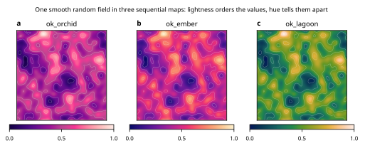
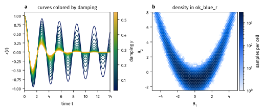

# rhdt-mpl

Personal Matplotlib defaults: PDF output through [umbruch](https://github.com/manuel-rhdt/umbruch) in Display P3, Noto fonts,
twelve colormaps, hummingbird palettes and OKLab color helpers.


## Install

```
pip install git+https://github.com/manuel-rhdt/umbruch-matplotlib
pip install git+https://github.com/manuel-rhdt/rhdt-mpl
pip install latex2mathml          # math ($...$) in labels
```

Python 3.12 or newer.

## Use

```python
import rhdt_mpl                                   # before pyplot
import matplotlib.pyplot as plt
from umbruch_matplotlib import rich

fig, axs = plt.subplots(1, 2, figsize=(rhdt_mpl.TWO_COLUMN, 2.8))
axs[0].plot(x, y, color="rhdt:colibri:ruby")
axs[0].set_xlabel(rich("time <i>t</i> (ms)"))
axs[0].set_ylabel(r"$\hat\rho_{ij}(t)$")
axs[1].imshow(z)                                  # ok_orchid
rhdt_mpl.panel_labels(axs)                        # bold a, b, ...
fig.savefig("fig.pdf")
```

## Palettes


```python
rhdt_mpl.palette("okabe-ito")                    # list of hex colors
rhdt_mpl.palette("colibri", ["ruby", "jade"])    # select and order by name
rhdt_mpl.set_cycle("ok8")                        # any palette, or "ok-print"
ax.set_prop_cycle(rhdt_mpl.cycle("ok6"))         # per axes
ax.plot(x, y, color="rhdt:colibri:ruby")         # rhdt:<palette>:<name>
ax.plot(x, y, color="rhdt:ruby")                 # short form: default palette (colibri)
```

All names with their colors: [docs/colors.md](docs/colors.md).


```python
rhdt_mpl.palette("starfrontlet")                     # gorget, crown, mantle, rump
ax.plot(x, y, color="rhdt:starfrontlet:gorget")      # the accent
ax.plot(x, theory, color="k", lw=2)                  # the theory line
ax.plot(x, other, color="rhdt:starfrontlet:rump")    # a quiet one
```

## Colormaps


```python
plt.imshow(z)                                              # ok_orchid, the default
plt.imshow(z, cmap="ok_ember")                             # also ok_lagoon
plt.imshow(z, cmap="ok_blue_r")                            # single-hue: ok_blue, ok_teal, ok_green, ok_orange, ok_red, ok_purple, ok_pink
plt.imshow(z, cmap="ok_ruby_sapphire", vmin=-m, vmax=m)    # diverging; also ok_green_magenta
```






## OKLab helpers


```python
from rhdt_mpl import oklab

oklab.muted("rhdt:colibri:amber")           # same hue, less chroma, a bit lighter
oklab.family("rhdt:colibri:sapphire", 3)    # three lightness steps of one hue
oklab.lighten("rhdt:colibri:sapphire", 0.1)
oklab.rotate_hue("rhdt:colibri:jade", -20)
oklab.mix("rhdt:colibri:ruby", "rhdt:colibri:sapphire", 0.3)
oklab.adjust("rhdt:colibri:ruby", dL=0.05, scale_C=0.8)
```

## Display P3

Colors are Display P3 numbers. Colors you write yourself (hex, names, built-in colormaps) are not converted:

```python
rhdt_mpl.from_srgb("tab:blue")           # sRGB color -> Display P3 numbers
rhdt_mpl.use(color_space="srgb")         # opt out
```

## Development

```
python examples/make_docs.py             # regenerate docs/ (needs pdftocairo and pikepdf)
python -m pytest tests
```

Hummingbird colors: Beltran, Shultz & Parra, [Dryad](https://doi.org/10.5061/dryad.02v6wwq8w). Noto fonts: SIL Open Font
License 1.1, see `src/rhdt_mpl/fonts/LICENSE-Noto-OFL.txt`.
