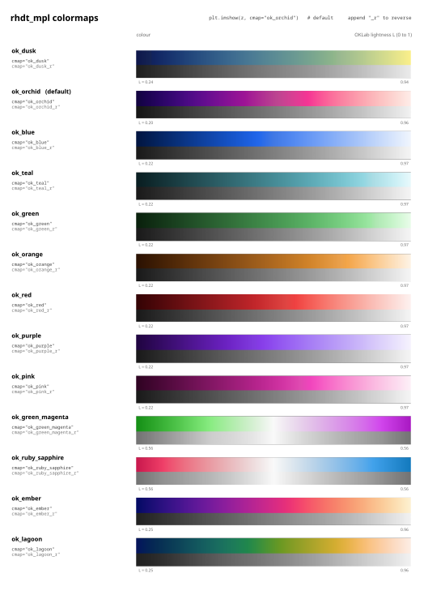
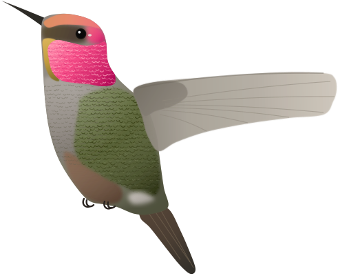
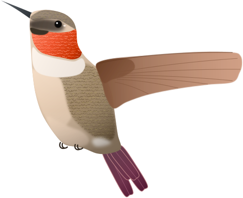
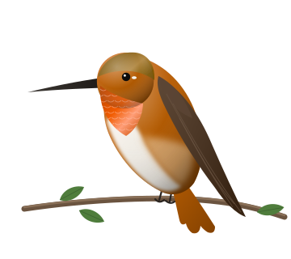
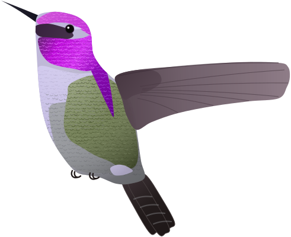
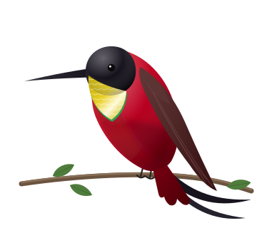
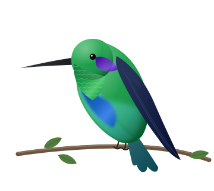
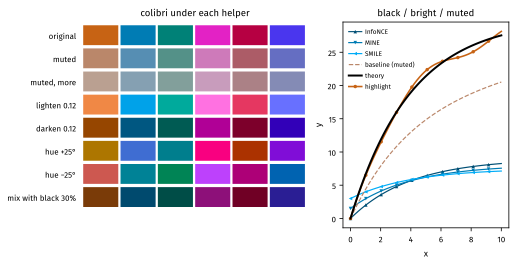

# rhdt-mpl

Personal Matplotlib defaults: the [umbruch](https://github.com/manuel-rhdt/umbruch) backend, bundled Noto fonts,
named palettes and cycles, nine colormaps, and helpers for adjusting colors in OKLab.

```python
import rhdt_mpl                      # import before pyplot
import matplotlib.pyplot as plt
```

Importing the package does five things:

1. selects the backend `module://umbruch_matplotlib` (PDF output with text and math laid out by umbruch),
2. registers the bundled Noto Sans, Noto Sans Mono, Noto Serif and Noto Sans Math with Matplotlib and starts umbruch with
   `--font-dir` pointing at them (the backend's default bridge uses `--no-system-fonts` and would not see them),
3. applies the style `rhdt.mplstyle` and the default color cycle,
4. registers the colormaps (`ok_orchid`, ... and their `_r` versions),
5. registers every palette color under the name `rhdt:<palette>:<name>` and every palette as a color sequence.

`rhdt_mpl.use(backend=False)` re-applies the style without changing the backend.

All figures below are produced by this package. They are drawn by the umbruch backend to PDF and converted to SVG with the
text as outlines (`python examples/make_docs.py`).

## Everything in one figure


Panels from the top left: **a** default style and cycle with a rich-text label and a math label; **b** the greyscale-safe
`ok-print` cycle; **c** the default colormap `ok_orchid`; **d** a reversed single-hue colormap; **e** named colors with a
black theory line, a bright highlight and a muted family; **f** the 8-color cycle. The script is `examples/features.py`.

## Style

The style follows the ML-PWS paper figures: full axes box in black, outward ticks, 8 pt text (axis labels 8.8 pt, titles
9.6 pt), 1.5 pt lines, markers of 4 pt without edge, legends without frame, constrained layout, `savefig.bbox = tight`.
The grid is off but styled (`#B0B0B0`, 0.8 pt); `ax.grid()` turns it on.

```python
import rhdt_mpl
fig, ax = plt.subplots(figsize=(rhdt_mpl.TWO_COLUMN, 2.8))   # 510 pt, the width of the paper figures
...
rhdt_mpl.panel_labels(axs)                                    # bold a, b, c, ... at the top left of each axes
fig.savefig("fig.pdf")
```

Labels may contain rich text and math, set by umbruch ([umbruch-matplotlib](https://github.com/manuel-rhdt/umbruch-matplotlib)):

```python
from umbruch_matplotlib import rich
ax.set_xlabel(rich("time <i>t</i> (ms)"))
ax.set_ylabel(r"$\hat\rho_{ij}(t)$")
```

## Palettes and cycles


The default cycle is Tol Vibrant without the grey (orange, blue, cyan, magenta, red, teal). Palettes:
`tol-bright`, `tol-vibrant`, `tol-muted`, `tol-pale`, `tol-dark`, `okabe-ito`, `colibri` (eight saturated hummingbird
jewel tones), the species palettes `anna`, `ruby-throated`, `rufous`, `costa`, `crimson-topaz` and `sparkling-violetear`, and
the two cycles `ok6` and `ok8`.
In the cycles `ok6`, `ok8` and `colibri` the first k colors are the best separated. The hummingbird palettes have their own section below.

```python
rhdt_mpl.palette("okabe-ito")                    # list of hex colors
rhdt_mpl.palette("tol-vibrant", ["orange", "teal"])   # select and order by name
rhdt_mpl.set_palette("okabe-ito")                # use as the color cycle
rhdt_mpl.set_cycle("ok8")                        # any palette, or "ok-print"
ax.set_prop_cycle(rhdt_mpl.cycle("ok6"))         # per axes
rhdt_mpl.use(backend=False)                      # back to the default cycle
```

`ok-print` pairs the `ok6` colors one-to-one with the line styles `-`, `--`, `:`, `-.`, `(0,(5,1,1,1))`, `(0,(1,1))`, so
that lines stay distinguishable in greyscale. `rhdt_mpl.PALETTES` holds the palettes as `{name: hex}` dicts; the colors are
those of <https://site.manuel-rhdt.de/post/colors/>.

## Individual colors by name

Every palette color is registered with Matplotlib as `"rhdt:<palette>:<name>"`, accepted wherever a color is, including
`rcParams` and the `oklab` helpers:

```python
ax.plot(x, y, color="rhdt:tol-vibrant:orange")
ax.bar(x, h, color="rhdt:tol-pale:pale blue", edgecolor="rhdt:tol-dark:dark blue")
ax.plot(x, y, color="rhdt:okabe-ito:sky blue")
```

The colors of the default palette (Tol Vibrant) also have the short form `"rhdt:orange"`. Other palettes have none,
because bare names are ambiguous: `blue` is three different colors across the palettes, and `ok6:navy` differs from
`ok8:navy`. Matplotlib's own CSS4 names (`"orange"`, `"navy"`) are untouched. `rhdt_mpl.named_colors()` lists all names.
The palettes are also available as `matplotlib.color_sequences["rhdt:ok6"]` and so on.

## Colormaps



256-entry sRGB tables designed in OKLab, with the OKLab lightness of each shown underneath. All run dark to light; append
`_r` for light to dark, which is the usual direction for single-hue maps on a white background. `ok_orchid` is the default
`image.cmap`.

```python
plt.imshow(z)                        # ok_orchid
plt.imshow(z, cmap="ok_dusk")        # multi-hue: ok_dusk, ok_orchid
plt.imshow(z, cmap="ok_blue_r")      # single-hue: ok_blue, ok_teal, ok_green, ok_orange, ok_red, ok_purple, ok_pink
```

## Hummingbird palettes


<table>
<tr><td align="center"><br><code>anna</code></td><td align="center"><br><code>ruby-throated</code></td><td align="center"><br><code>rufous</code></td></tr>
<tr><td align="center"><br><code>costa</code></td><td align="center"><br><code>crimson-topaz</code></td><td align="center"><br><code>sparkling-violetear</code></td></tr>
</table>

Anna's hummingbird is drawn by hand after a reference photograph (`examples/draw_anna.py`; `examples/trace_hummingbird.py`
traces a photograph into color regions as a reference); the others are drawn from their palettes
(`examples/draw_hummingbirds.py`).

Two kinds of palette, both named after hummingbirds:

- **`colibri`**: eight saturated jewel tones from different species, ordered so that the first k colors are the best
  separated: violetear `#710bc6`, topaz `#e8ca17`, ruby `#c6001f`, emerald `#00ae64`, fuchsia `#e825bc`, copper `#db7d24`,
  sapphire `#005dca`, turquoise `#31c8c9`. Use it as a cycle: `rhdt_mpl.set_cycle("colibri")`.
- **One palette per species**, with colors named after the plumage parts, designed in OKLCH from the general appearance of
  the adult male (Anna's hummingbird is sampled from a photograph; the others are from memory): `anna` (*Calypte anna*), `ruby-throated` (*Archilochus colubris*),
  `rufous` (*Selasphorus rufus*), `costa` (*Calypte costae*), `crimson-topaz` (*Topaza pella*) and `sparkling-violetear`
  (*Colibri coruscans*). The gorget, or the most striking patch, comes first. A bird is one bright accent on a quiet body,
  which is the pattern for data too: a bright gorget for the result that matters, a near-black bill or wing for a theory line, the
  back and flank for secondary lines.

```python
rhdt_mpl.palette("anna")                         # gorget, back, flank, belly, wing, bill
rhdt_mpl.palette("anna", ["gorget", "wing"])     # select and order by name
ax.plot(x, y, color="rhdt:anna:gorget")          # the accent
ax.plot(x, theory, color="rhdt:anna:bill", lw=2) # a dark line
ax.plot(x, other, color="rhdt:anna:flank")       # a quiet one
```

The belly and bill colors are light and near-black neutrals. They are meant for fills, lines and text, not for a cycle,
so use the species palettes by name and `colibri` for cycles. The names are in the table `rhdt_mpl.PALETTES`.

## Color helpers in OKLab



```python
from rhdt_mpl import oklab

oklab.muted("rhdt:orange")                  # same hue, less chroma, a bit lighter: for secondary lines
oklab.family("rhdt:tol-vibrant:cyan", 3)    # three lightness steps of one hue, dark to light
oklab.lighten("#0077BB", 0.1)               # +0.1 OKLab lightness
oklab.darken("#0077BB", 0.1)
oklab.rotate_hue("#009988", -20)            # degrees in OKLCH
oklab.mix("#EE7733", "#0077BB", 0.3)        # interpolate in OKLab
oklab.adjust("#EE7733", dL=0.05, scale_C=0.8)   # set or shift L, C, h, or scale C
oklab.to_oklab(c), oklab.to_oklch(c), oklab.oklab(L, a, b), oklab.oklch(L, C, h), oklab.lightness(c)
```

All functions take any Matplotlib color and return `#rrggbb`. A result outside the sRGB gamut is brought back by reducing
chroma at constant lightness and hue, not by clipping channels. `family` varies lightness only, so members of a family
should also differ in marker or dash (hue alone is not enough for everyone).

## Installation

```
pip install --no-deps git+https://github.com/manuel-rhdt/rhdt-mpl
pip install matplotlib
```

The package needs two things that are not on PyPI:

- the **umbruch** executable (`$UMBRUCH`, `PATH`, or the `umbruch` Python package), from
  <https://github.com/manuel-rhdt/umbruch>, and
- **umbruch-matplotlib**, from <https://github.com/manuel-rhdt/umbruch-matplotlib>. Its `pip` dependency on
  `umbruch>=0.5.0` cannot be resolved from PyPI; install it with `--no-deps` when the executable is installed separately.

The math font (Noto Sans Math, set through `umbruch_matplotlib.config.math_font`) needs a version of umbruch-matplotlib that
has this option. Without it the attribute is set but ignored, and formulas are set in umbruch's built-in math fonts.

Fonts: Noto Sans, Noto Sans Mono, Noto Serif and Noto Sans Math (SIL Open Font License 1.1, see
`src/rhdt_mpl/fonts/LICENSE-Noto-OFL.txt`), about 5 MB.

## Development

```
python examples/make_docs.py                          # regenerate docs/*.svg (needs umbruch and pdftocairo)
UMBRUCH=/path/to/umbruch python tests/test_rhdt_mpl.py
python tests/test_oklab.py
```

`examples/` also holds `gallery.py` (a four-panel figure), `compare_cycles.py` (the same data under several cycles) and
`design_species_palettes.py` (the OKLCH recipe of the species palettes).
