# rhdt-mpl

Personal Matplotlib defaults: the [umbruch](https://github.com/manuel-rhdt/umbruch) backend, bundled Noto fonts,
named palettes and cycles, nine colormaps, and helpers for adjusting colors in OKLab.

```python
import rhdt_mpl                      # import before pyplot
import matplotlib.pyplot as plt
```

Importing the package does five things:

1. selects the backend `module://umbruch_matplotlib` (PDF output with text and math laid out by umbruch),
2. registers the bundled Noto Sans, Noto Sans Mono, Noto Serif and Noto Sans Math with Matplotlib and starts umbruch with
   `--font-dir` pointing at them (the backend's default bridge uses `--no-system-fonts` and would not see them),
3. applies the style `rhdt.mplstyle` and the default color cycle,
4. registers the colormaps (`ok_orchid`, ... and their `_r` versions),
5. registers every palette color under the name `rhdt:<palette>:<name>` and every palette as a color sequence.

`rhdt_mpl.use(backend=False)` re-applies the style without changing the backend.

All figures below are produced by this package. They are drawn by the umbruch backend to PDF and converted to SVG with the
text as outlines (`python examples/make_docs.py`).

## Everything in one figure

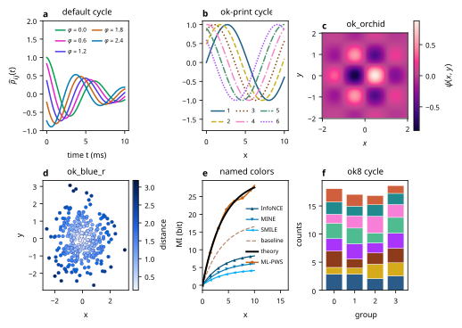

Panels from the top left: **a** default style and cycle with a rich-text label and a math label; **b** the greyscale-safe
`ok-print` cycle; **c** the default colormap `ok_orchid`; **d** a reversed single-hue colormap; **e** named colors with a
black theory line, a bright highlight and a muted family; **f** the 8-color cycle. The script is `examples/features.py`.

## Style

The style follows the ML-PWS paper figures: full axes box in black, outward ticks, 8 pt text (axis labels 8.8 pt, titles
9.6 pt), 1.5 pt lines, markers of 4 pt without edge, legends without frame, constrained layout, `savefig.bbox = tight`.
The grid is off but styled (`#B0B0B0`, 0.8 pt); `ax.grid()` turns it on.

```python
import rhdt_mpl
fig, ax = plt.subplots(figsize=(rhdt_mpl.TWO_COLUMN, 2.8))   # 510 pt, the width of the paper figures
...
rhdt_mpl.panel_labels(axs)                                    # bold a, b, c, ... at the top left of each axes
fig.savefig("fig.pdf")
```

Labels may contain rich text and math, set by umbruch ([umbruch-matplotlib](https://github.com/manuel-rhdt/umbruch-matplotlib)):

```python
from umbruch_matplotlib import rich
ax.set_xlabel(rich("time <i>t</i> (ms)"))
ax.set_ylabel(r"$\hat\rho_{ij}(t)$")
```

## Palettes and cycles


The default cycle is `colibri` (eight colors measured in hummingbirds, see below). Palettes:
`okabe-ito`, `colibri` (eight vivid colors measured in
hummingbirds, the default) and `colibri-dark` (their darker partners), the species palettes `sunangel`, `ruby-topaz`, `starfrontlet`, `sapphire`, `violet-crowned` and `broad-billed`, and
the two cycles `ok6` and `ok8`.
In the cycles `ok6`, `ok8` and `colibri` the first k colors are the best separated. The hummingbird palettes have their own section below.

```python
rhdt_mpl.palette("okabe-ito")                    # list of hex colors
rhdt_mpl.palette("colibri", ["ruby", "jade"])   # select and order by name
rhdt_mpl.set_palette("okabe-ito")                # use as the color cycle
rhdt_mpl.set_cycle("ok8")                        # any palette, or "ok-print"
ax.set_prop_cycle(rhdt_mpl.cycle("ok6"))         # per axes
rhdt_mpl.use(backend=False)                      # back to the default cycle
```

`ok-print` pairs the `ok6` colors one-to-one with the line styles `-`, `--`, `:`, `-.`, `(0,(5,1,1,1))`, `(0,(1,1))`, so
that lines stay distinguishable in greyscale. `rhdt_mpl.PALETTES` holds the palettes as `{name: hex}` dicts; Okabe–Ito is
as listed at <https://site.manuel-rhdt.de/post/colors/>.

## Individual colors by name

Every palette color is registered with Matplotlib as `"rhdt:<palette>:<name>"`, accepted wherever a color is, including
`rcParams` and the `oklab` helpers:

```python
ax.plot(x, y, color="rhdt:colibri:ruby")
ax.bar(x, h, color="rhdt:colibri:sapphire", edgecolor="rhdt:colibri-dark:lapis")
ax.plot(x, y, color="rhdt:okabe-ito:sky blue")
```

The colors of the default palette (`colibri`) also have the short form `"rhdt:ruby"`. Other palettes have none,
because bare names are ambiguous: `ok6:navy` differs from
`ok8:navy`. Matplotlib's own CSS4 names (`"orange"`, `"navy"`) are untouched. `rhdt_mpl.named_colors()` lists all names.
The palettes are also available as `matplotlib.color_sequences["rhdt:ok6"]` and so on. The table below lists every name.

<!-- named-colors:begin -->
<details>
<summary>All 94 named colors (click to expand)</summary>

The full name of every color is `rhdt:<palette>:<name>`; the colors of the default palette (`colibri`) also have the short form `rhdt:<name>`. Hex values are sRGB; for colors outside sRGB the hex is the nearest sRGB color.

| | name | hex | notes |
|---|---|---|---|
|  | `rhdt:okabe-ito:black` | `#000000` |  |
|  | `rhdt:okabe-ito:orange` | `#e69f00` |  |
|  | `rhdt:okabe-ito:sky blue` | `#56b4e9` |  |
|  | `rhdt:okabe-ito:bluish green` | `#009e73` |  |
|  | `rhdt:okabe-ito:yellow` | `#f0e442` |  |
|  | `rhdt:okabe-ito:blue` | `#0072b2` |  |
|  | `rhdt:okabe-ito:vermilion` | `#d55e00` |  |
|  | `rhdt:okabe-ito:reddish purple` | `#cc79a7` |  |
|  | `rhdt:ok6:navy` | `#1d5e85` |  |
|  | `rhdt:ok6:gold` | `#c8b222` |  |
|  | `rhdt:ok6:brown` | `#8b3e09` |  |
|  | `rhdt:ok6:pink` | `#f487c5` |  |
|  | `rhdt:ok6:green` | `#469172` |  |
|  | `rhdt:ok6:violet` | `#a351fb` |  |
|  | `rhdt:colibri:emerald` | `#00a051` | also `rhdt:emerald`; Urosticte benjamini ♂ gorget, 2 specimens; exact color outside sRGB: `oklch(0.6187 0.2364 151.88)` |
|  | `rhdt:colibri:tourmaline` | `#e422c5` | also `rhdt:tourmaline`; Heliangelus strophianus ♂ gorget, 2 specimens |
|  | `rhdt:colibri:amethyst` | `#4a36ee` | also `rhdt:amethyst`; Eriocnemis vestita ♂ gorget, 15 specimens |
|  | `rhdt:colibri:amber` | `#c76313` | also `rhdt:amber`; Coeligena bonapartei ♂ rump, 5 specimens |
|  | `rhdt:colibri:sapphire` | `#007cb3` | also `rhdt:sapphire`; Lepidopyga coeruleogularis ♂ gorget, 2 specimens; exact color outside sRGB: `oklch(0.5563 0.1832 238.53)` |
|  | `rhdt:colibri:ruby` | `#b60042` | also `rhdt:ruby`; Chrysolampis mosquitus ♂ crown, 4 specimens; exact color outside sRGB: `oklch(0.4949 0.2091 12.29)` |
|  | `rhdt:colibri:jade` | `#008176` | also `rhdt:jade`; Aglaiocercus coelestis ♀ crown, 9 specimens; exact color outside sRGB: `oklch(0.5437 0.1601 184.45)` |
|  | `rhdt:colibri:peridot` | `#7d8c00` | also `rhdt:peridot`; Eriocnemis vestita ♂ rump, 15 specimens; exact color outside sRGB: `oklch(0.6075 0.1413 117.03)` |
|  | `rhdt:colibri-dark:malachite` | `#07841c` | Lafresnaya lafresnayi ♂ gorget, 2 specimens; darker partner of `emerald` |
|  | `rhdt:colibri-dark:rhodolite` | `#a54570` | Heliomaster longirostris ♂ gorget, 3 specimens; darker partner of `tourmaline` |
|  | `rhdt:colibri-dark:iolite` | `#212a8c` | Goldmania violiceps ♂ crown, 2 specimens; darker partner of `amethyst` |
| 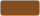 | `rhdt:colibri-dark:bronzite` | `#844d1e` | Androdon aequatorialis ♂ crown, 2 specimens; darker partner of `amber` |
|  | `rhdt:colibri-dark:lapis` | `#0044d3` | Chrysuronia oenone ♂ crown, 2 specimens; darker partner of `sapphire`; exact color outside sRGB: `oklch(0.4614 0.2307 262.71)` |
|  | `rhdt:colibri-dark:garnet` | `#6c1f1d` | Topaza pyra ♂ belly, 2 specimens; darker partner of `ruby` |
|  | `rhdt:colibri-dark:apatite` | `#005761` | Aglaiocercus coelestis ♂ rump, 13 specimens; darker partner of `jade`; exact color outside sRGB: `oklch(0.4169 0.0823 208.45)` |
|  | `rhdt:colibri-dark:serpentine` | `#414900` | Heliodoxa imperatrix ♂ crown, 2 specimens; darker partner of `peridot`; exact color outside sRGB: `oklch(0.3841 0.0923 116.88)` |
|  | `rhdt:sunangel:gorget` | `#e444b6` |  |
|  | `rhdt:sunangel:crown` | `#30721e` |  |
| 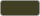 | `rhdt:sunangel:belly` | `#413f23` |  |
|  | `rhdt:sunangel:mantle` | `#3e5509` |  |
| 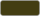 | `rhdt:sunangel:rump` | `#433d12` |  |
| 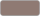 | `rhdt:sunangel:wing` | `#8f7a73` |  |
| 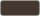 | `rhdt:sunangel:tail` | `#443730` |  |
|  | `rhdt:sunangel:bill` | `#464746` |  |
|  | `rhdt:ruby-topaz:gorget` | `#ff8a1b` | exact color outside sRGB: `oklch(0.7483 0.1858 57.05)` |
|  | `rhdt:ruby-topaz:crown` | `#ba0040` | exact color outside sRGB: `oklch(0.4949 0.2091 12.29)` |
| 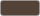 | `rhdt:ruby-topaz:belly` | `#554236` |  |
| 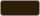 | `rhdt:ruby-topaz:mantle` | `#2e1d09` |  |
| 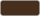 | `rhdt:ruby-topaz:rump` | `#462f1d` |  |
| 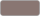 | `rhdt:ruby-topaz:wing` | `#897672` |  |
| 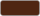 | `rhdt:ruby-topaz:tail` | `#4f2612` |  |
| 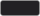 | `rhdt:ruby-topaz:bill` | `#222124` |  |
|  | `rhdt:starfrontlet:gorget` | `#6842e7` |  |
|  | `rhdt:starfrontlet:crown` | `#00d645` | exact color outside sRGB: `oklch(0.7475 0.2549 149.96)` |
| 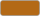 | `rhdt:starfrontlet:belly` | `#b36916` |  |
| 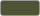 | `rhdt:starfrontlet:mantle` | `#4f5436` |  |
|  | `rhdt:starfrontlet:rump` | `#c76313` |  |
| 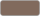 | `rhdt:starfrontlet:wing` | `#816a5d` |  |
| 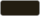 | `rhdt:starfrontlet:tail` | `#231d11` |  |
| 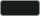 | `rhdt:starfrontlet:bill` | `#1a1b1b` |  |
|  | `rhdt:sapphire:gorget` | `#0043be` | exact color outside sRGB: `oklch(0.4333 0.2055 258.45)` |
|  | `rhdt:sapphire:crown` | `#0043d6` | exact color outside sRGB: `oklch(0.4614 0.2307 262.71)` |
|  | `rhdt:sapphire:belly` | `#4d661f` |  |
|  | `rhdt:sapphire:mantle` | `#446817` |  |
| 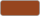 | `rhdt:sapphire:rump` | `#96451e` |  |
| 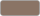 | `rhdt:sapphire:wing` | `#8a7465` |  |
| 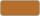 | `rhdt:sapphire:tail` | `#b66f2b` |  |
| 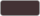 | `rhdt:sapphire:bill` | `#433234` |  |
|  | `rhdt:violet-crowned:crown` | `#6c41b8` |  |
|  | `rhdt:violet-crowned:throat` | `#d9d7d5` |  |
|  | `rhdt:violet-crowned:belly` | `#cdcbc6` |  |
| 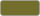 | `rhdt:violet-crowned:back` | `#746e2c` |  |
| 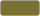 | `rhdt:violet-crowned:rump` | `#787132` |  |
| 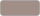 | `rhdt:violet-crowned:wing` | `#a18e86` |  |
| 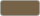 | `rhdt:violet-crowned:tail` | `#756247` |  |
| 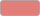 | `rhdt:violet-crowned:bill` | `#e27e78` |  |
|  | `rhdt:broad-billed:gorget` | `#272b90` |  |
|  | `rhdt:broad-billed:crown` | `#4e9560` |  |
|  | `rhdt:broad-billed:belly` | `#21501b` |  |
|  | `rhdt:broad-billed:rump` | `#375e39` |  |
|  | `rhdt:broad-billed:vent` | `#b8b7b3` |  |
| 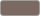 | `rhdt:broad-billed:wing` | `#7b6a61` |  |
|  | `rhdt:broad-billed:tail` | `#181c25` |  |
|  | `rhdt:broad-billed:bill` | `#ed6f41` |  |
|  | `rhdt:ok8:navy` | `#2a5b88` |  |
|  | `rhdt:ok8:gold` | `#d6ab1b` |  |
| 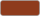 | `rhdt:ok8:rust` | `#8e3b1c` |  |
|  | `rhdt:ok8:violet` | `#a936fb` |  |
|  | `rhdt:ok8:mint` | `#4fbc90` |  |
|  | `rhdt:ok8:pink` | `#f87fd8` |  |
|  | `rhdt:ok8:teal` | `#228a8f` |  |
|  | `rhdt:ok8:coral` | `#d0603d` |  |

</details>
<!-- named-colors:end -->

## Colormaps


256-entry sRGB tables designed in OKLab, with the OKLab lightness of each shown underneath. All run dark to light; append
`_r` for light to dark, which is the usual direction for single-hue maps on a white background. `ok_orchid` is the default
`image.cmap`.

```python
plt.imshow(z)                        # ok_orchid
plt.imshow(z, cmap="ok_dusk")        # multi-hue: ok_dusk, ok_orchid
plt.imshow(z, cmap="ok_blue_r")      # single-hue: ok_blue, ok_teal, ok_green, ok_orange, ok_red, ok_purple, ok_pink
```

## Hummingbird palettes


<table>
<tr><td align="center">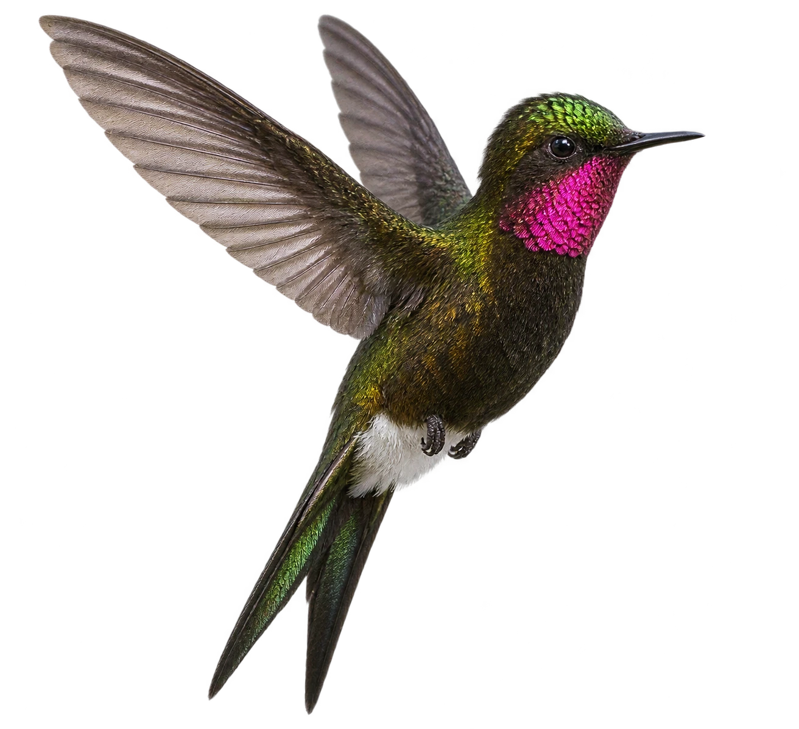<br><code>sunangel</code><br>Tourmaline sunangel<br><i>Heliangelus exortis</i></td><td align="center"><br><code>ruby-topaz</code><br>Ruby-topaz<br><i>Chrysolampis mosquitus</i></td><td align="center"><br><code>starfrontlet</code><br>Golden-bellied starfrontlet<br><i>Coeligena bonapartei</i></td></tr>
<tr><td align="center"><br><code>sapphire</code><br>Golden-tailed sapphire<br><i>Chrysuronia oenone</i></td><td align="center">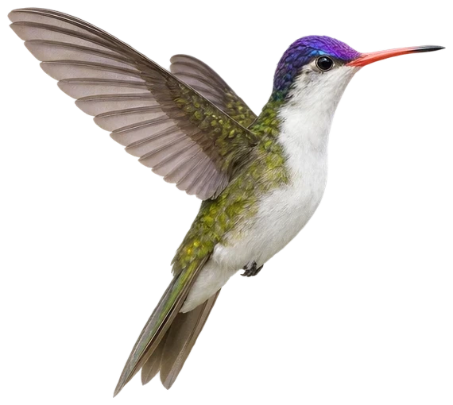<br><code>violet-crowned</code><br>Violet-crowned hummingbird<br><i>Ramosomyia violiceps</i></td><td align="center">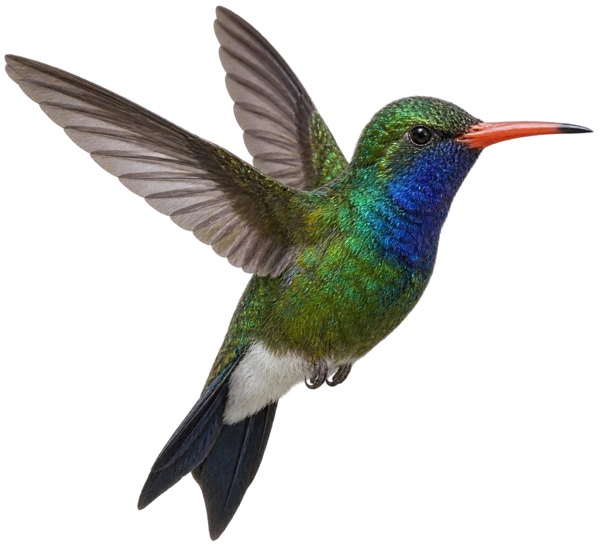<br><code>broad-billed</code><br>Broad-billed hummingbird<br><i>Cynanthus latirostris</i></td></tr>
</table>

The birds are generated reference images (males, hovering), not photographs. Two kinds of palette are named after
hummingbirds:

- **`colibri`** (the default cycle) and **`colibri-dark`**: colors taken only from the measured spectra of the database below,
  mixing species and patches freely. `colibri` has eight bright, vivid colors, one per hue, named after gems: `ruby`,
  `amber`, `peridot` (the olive-yellow), `emerald`, `jade`, `sapphire`, `amethyst` and `tourmaline`. Every one is at least 3:1
  against white (the WCAG minimum for graphics), so they stay visible as thin lines on a screen; the dataset has no bright yellow
  that meets this, so the yellowish color is an olive. The first six colors are the distinct ones: as displayed they are at
  least 16.9 apart (OKLab, times 100), and no pair shares a hue family. The last two, `jade` and `peridot`, add a teal and an
  olive-yellow and are allowed to resemble earlier colors (`jade` is 10.3 from `sapphire`, `peridot` 9.4 from `emerald`); from
  this dataset there are only about six clearly distinct bright hues, and a more distinct olive would be a dark, drab one.
  `colibri-dark` gives each of them a darker
  partner of similar hue, named after a gem of that color and in the same order, for secondary or background series:
  `malachite` (of `emerald`), `rhodolite` (`tourmaline`), `iolite` (`amethyst`), `bronzite` (`amber`), `lapis` (`sapphire`),
  `garnet` (`ruby`), `apatite` (`jade`) and `serpentine` (`peridot`); `rhdt_mpl.PARTNERS` maps each dark name to its bright one. Each color comes
  from one species and patch: `rhdt_mpl.SOURCES["colibri"]` lists species, sex, patch and the number of specimens, for example
  `ruby` is the crown of the ruby-topaz (4 specimens) and `amethyst` the gorget of the glowing puffleg (15).
  Use them by name, `rhdt:colibri:ruby` and `rhdt:colibri-dark:garnet`, or as cycles: `rhdt_mpl.set_cycle("colibri")`.
- **One palette per species**, eight colors named after plumage parts, the most striking patch first: `sunangel`,
  `ruby-topaz`, `starfrontlet`, `sapphire`, `violet-crowned` (its first color is the `crown`, then the white `throat`) and
  `broad-billed`. For the first four, the **gorget, crown, belly, mantle and rump are measured reflectance spectra** of males
  from the Colombian hummingbird database of Beltran, Shultz & Parra (*Evolution*,
  [Dryad](https://doi.org/10.5061/dryad.02v6wwq8w)), taken at the angle of maximum reflectance and converted to sRGB (CIE 1931
  observer, D65; colors outside the sRGB gamut are brought back by reducing chroma at constant OKLab lightness and hue,
  which affects the ruby-topaz crown and gorget, the starfrontlet crown and the sapphire crown and gorget).
  The **wing, tail and bill** are not in the database and are sampled from the images, as are all colors of the
  violet-crowned and broad-billed hummingbirds, which the database does not contain (the broad-billed has a `vent` color,
  the white undertail). `examples/build_species_palettes.py` builds the palettes and prints how far each measured patch is
  from the image.

```python
rhdt_mpl.palette("ruby-topaz")                       # gorget, crown, belly, mantle, rump, wing, tail, bill
rhdt_mpl.palette("ruby-topaz", ["gorget", "tail"])   # select and order by name
ax.plot(x, y, color="rhdt:ruby-topaz:gorget")        # the accent
ax.plot(x, theory, color="rhdt:ruby-topaz:mantle", lw=2)   # a dark line
ax.plot(x, other, color="rhdt:ruby-topaz:rump")      # a quiet one
```

A bird is one bright accent on a quiet body, which is the pattern for data too: a bright gorget for the result that
matters, a dark part for a theory line, quieter parts for secondary lines. Iridescent colors depend on the viewing angle, and
the spectra were measured on museum study skins and live birds, so the measured colors are one view of each patch. The
images agree with the measurements within ΔE 2 to 13 (OKLab, times 100) for the gorgets and crowns; the largest differences
are the ruby-topaz belly (22, nearly black in the image and brown in the measurement) and the starfrontlet rump (17). The
palettes use the measurements. The `colibri` palettes are the ones meant for cycles; the species palettes are for choosing
colors by name.

### Colors outside sRGB

Some measured colors, mostly iridescent greens, blues and reds, lie outside the sRGB gamut (5.5 % of the database).
Matplotlib only knows sRGB, so the palettes hold their **nearest sRGB color** (chroma reduced at constant OKLab lightness and
hue) and keep the **exact color** separately: `rhdt_mpl.wide_css("colibri", "ruby")` returns
`"oklch(0.4949 0.2091 12.29)"`, and `rhdt_mpl.WIDE` has all of them (for the colibri palettes and the measured patches of the
species palettes). They are marked with a dot in the figure above.

In a PDF the exact colors are used. The backend (`umbruch_matplotlib.config.wide_colors`, filled by `rhdt_mpl.wide_colors()`)
replaces each sRGB stand-in in the SVG by its `oklch()` string just before umbruch renders it, and umbruch (a version that reads
wide colors in SVG) writes them as CIELAB colors, for lines, bars, markers and text alike. The replacement is by hex value, so a
plain `"#b60042"` you pass yourself becomes the wide ruby too; and two entries with the same stand-in but different exact colors
are left as sRGB. SVG output and any other Matplotlib backend show the sRGB stand-ins. On a screen or print that cannot show a
wide color, the viewer maps it to its own gamut, so check that the difference matters for your medium before relying on it.

## Color helpers in OKLab


```python
from rhdt_mpl import oklab

oklab.muted("rhdt:colibri:amber")        # same hue, less chroma, a bit lighter: for secondary lines
oklab.family("rhdt:colibri:coeruleogularis gorget", 3)    # three lightness steps of one hue, dark to light
oklab.lighten("#007cb3", 0.1)               # +0.1 OKLab lightness
oklab.darken("#007cb3", 0.1)
oklab.rotate_hue("#009988", -20)            # degrees in OKLCH
oklab.mix("#de421b", "#007cb3", 0.3)        # interpolate in OKLab
oklab.adjust("#de421b", dL=0.05, scale_C=0.8)   # set or shift L, C, h, or scale C
oklab.to_oklab(c), oklab.to_oklch(c), oklab.oklab(L, a, b), oklab.oklch(L, C, h), oklab.lightness(c)
```

All functions take any Matplotlib color and return `#rrggbb`. A result outside the sRGB gamut is brought back by reducing
chroma at constant lightness and hue, not by clipping channels. `family` varies lightness only, so members of a family
should also differ in marker or dash (hue alone is not enough for everyone).

## Installation

```
pip install --no-deps git+https://github.com/manuel-rhdt/rhdt-mpl
pip install matplotlib
```

The package needs two things that are not on PyPI:

- the **umbruch** executable (`$UMBRUCH`, `PATH`, or the `umbruch` Python package), from
  <https://github.com/manuel-rhdt/umbruch>, and
- **umbruch-matplotlib**, from <https://github.com/manuel-rhdt/umbruch-matplotlib>. Its `pip` dependency on
  `umbruch>=0.5.0` cannot be resolved from PyPI; install it with `--no-deps` when the executable is installed separately.

The math font (Noto Sans Math, set through `umbruch_matplotlib.config.math_font`) needs a version of umbruch-matplotlib that
has this option. Without it the attribute is set but ignored, and formulas are set in umbruch's built-in math fonts.

Fonts: Noto Sans, Noto Sans Mono, Noto Serif and Noto Sans Math (SIL Open Font License 1.1, see
`src/rhdt_mpl/fonts/LICENSE-Noto-OFL.txt`), about 5 MB.

## Development

```
python examples/make_docs.py                          # regenerate docs/*.svg (needs umbruch and pdftocairo)
UMBRUCH=/path/to/umbruch python tests/test_rhdt_mpl.py
python tests/test_oklab.py
```

`examples/` also holds `gallery.py` (a four-panel figure), `compare_cycles.py` (the same data under several cycles),
`colombia_spectra.py` (reflectance spectra to sRGB), `colombia_overview.py` and `colombia_picks.py` (figures of the Colombian
species) and `build_species_palettes.py`; the spectra are not in the repository.
